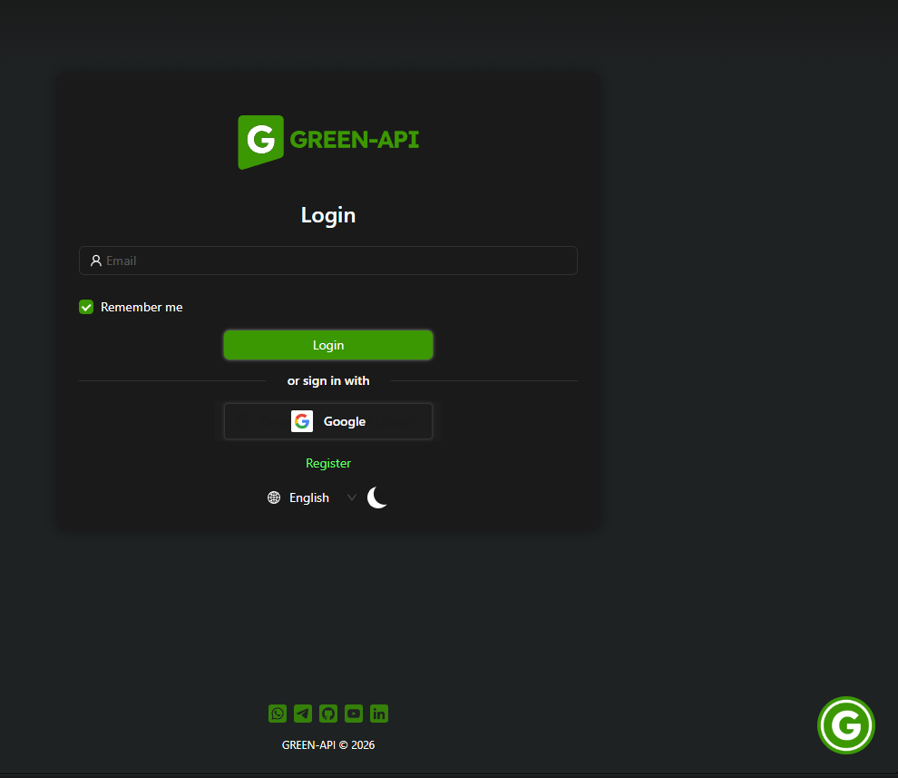
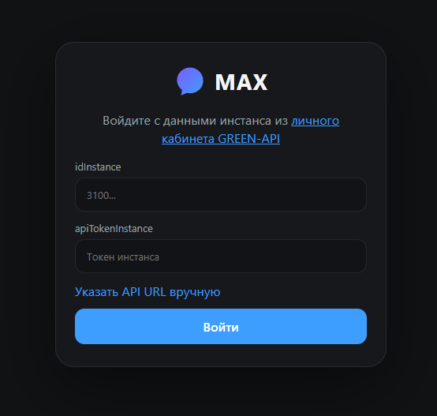

# GREEN-API MAX Chat (Тестовое задание)

[Ссылка на живое демо](https://ваша-ссылка.vercel.app)

## 📸 Скриншоты
<!-- Вставьте сюда ссылки на загруженные в GitHub картинки -->

## 🚀 Технологии
- React 19
- TypeScript
- Vite
- Context API (для стейта)
- Vitest (тесты)

## 🛠️ Локальный запуск

1. Клонируйте репозиторий:
   `git clone https://github.com/julia-riga/green-api-max.git`
2. Установите зависимости:
   `npm install`
3. Создайте файл `.env` в корне и добавьте:
   `VITE_GREEN_API_URL=https://api.green-api.com`
4. Запустите dev-сервер:
   `npm run dev`

## 🧪 Тесты
Запуск тестов: `npm run test`

## 📝 Функционал
- Авторизация по `idInstance` и `apiTokenInstance`.
- Валидация номера телефона перед созданием чата.
- Отправка и получение текстовых сообщений (Long Polling).
- Обработка ошибок (неверный токен, неавторизованный инстанс).
